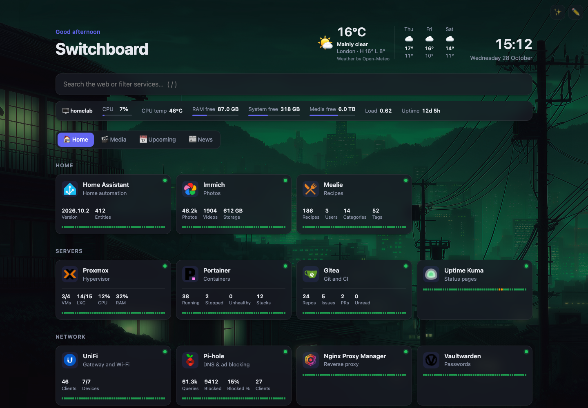
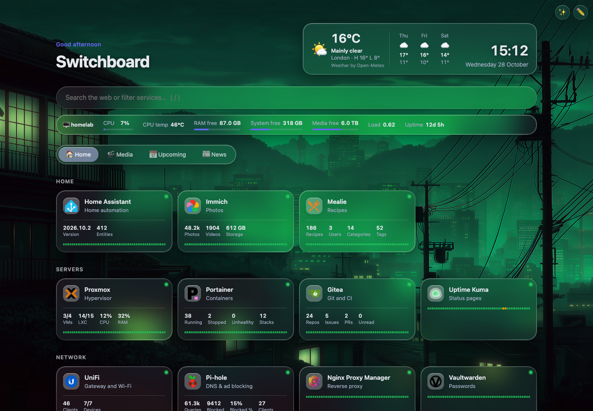
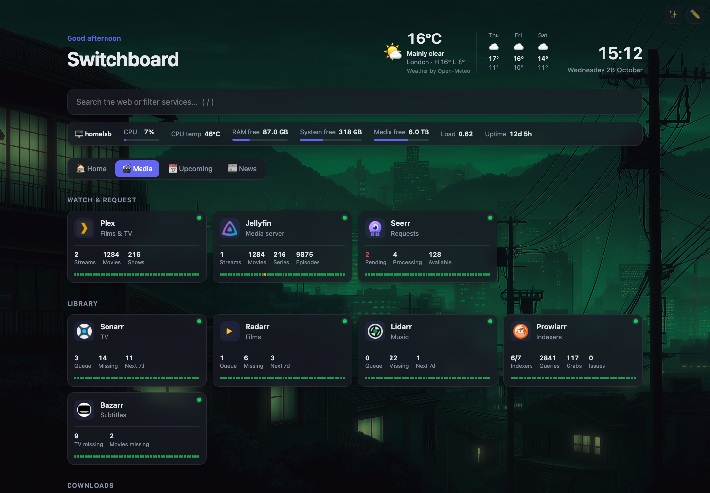
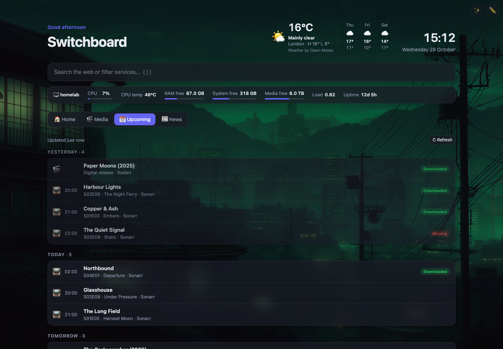

# Switchboard

Switchboard is a small, self-hosted start page for your home lab. It has no dependencies: one Python file serves a vanilla HTML/JS front end.



| Glass style | App widgets | Upcoming tab |
|---|---|---|
|  |  |  |

*Screenshots show a demo setup with made-up data.*

- **Tabs** to keep related services on their own page (e.g. Home, Media, Network). Switch with the keys **1**–**9**, or link straight to one with `#tab-name`
- Service tiles arranged in groups, with icons, descriptions and **live online/offline status**
- **App widgets**: live stats from your apps' APIs shown on their tiles. Built in for the *arr suite, Seerr, Plex, Jellyfin, Emby, Tautulli, Komga, BookOrbit, Magarr, Proxmox, Portainer, Dockge, UniFi, Pi-hole, AdGuard Home, Technitium, Gitea, Home Assistant, Mealie, Immich, qBittorrent, SABnzbd and NZBGet, plus any other JSON API
- **Alerts to Discord** (or any JSON webhook) when a service goes down or comes back, an app widget shows a warning, or the host runs hot or short of RAM or disk. Checks run on the server, so alerts arrive even when nobody has the page open
- **24-hour uptime bars** on every checked tile
- **Upcoming tab**: one calendar combining your Sonarr, Radarr, Lidarr, Readarr and Magarr, grouped by day and marked Downloaded or Missing
- **System stats bar** for the machine running the dashboard: CPU usage and temperature, free RAM, free space on each disk you list, load and uptime. Turn it on or off in Settings
- **Weather widget** showing current conditions and a 3-day forecast, from [Open-Meteo](https://open-meteo.com). It's free and needs no API key
- **News tab (RSS reader)** showing your RSS and Atom feeds as cards. Switch it on or off in Settings. It comes with sample feeds, including GitHub release feeds so you can see when your self-hosted apps have updates
- **Find services**: scan your machines for apps that aren't on the dashboard yet, and add them with icons and widgets ready
- **In-browser editing**: add, edit, delete and reorder tabs, groups and services. You can also drag a tile onto a tab to move it there
- **Two interface styles**: Normal, or **Glass**, a translucent look inspired by Apple's Liquid Glass. Set the default for everyone in Settings, or press ✨ (or **G**) to switch on just one device
- Settings for title, theme (auto/light/dark), accent colour, tile size, background image and search engine
- **Custom backgrounds**: upload an image from your computer or phone, pick one you uploaded earlier, or paste an image URL
- Search bar that filters services across all tabs as you type, or searches the web on Enter
- Raw JSON editor, plus import and export of the config
- **Protected editing**: an edit token is generated on first start, so guests on your network can't change the page, and other websites can't make the server act for them
- Status checks run on the server: no CORS problems, and self-signed certificates are fine

## Run it

**Python** (3.8 or newer, no packages needed; tested on 3.12 and 3.14):

```sh
python3 server.py
# → http://localhost:3000
```

**Docker** (images for amd64 and arm64, so a Raspberry Pi works too):

```sh
docker run -d --name switchboard -p 3000:3000 -v ./config:/app/config ghcr.io/ahammerton/switchboard:latest
```

Or build it yourself with `docker compose up -d --build`, using the `docker-compose.yml` in this repo.

On first start:

- **The config** is created at `config/config.json` from `default-config.json`.
- **An edit token** is generated and printed in the log (`docker logs switchboard`). It's also saved as `config/edit-token`. The dashboard asks for it the first time you save a change in a browser.

## Configuration

| Env var      | Default    | Purpose                                         |
|--------------|------------|-------------------------------------------------|
| `PORT`       | `3000`     | Listen port                                     |
| `HOST`       | `0.0.0.0`  | Bind address                                    |
| `CONFIG_DIR` | `./config` | Where `config.json` lives                       |
| `EDIT_TOKEN` | *(generated)* | The token needed to change anything. If you don't set one, it's generated on first start and kept in `config/edit-token`. `off` allows changes without a token. |
| `ALLOWED_HOSTS` | *(none)* | Extra host names the dashboard may be opened under, comma-separated, e.g. `dash.example.com` or `*.example.com`. IP addresses, `localhost` and private names (`.lan`, `.local`, `.home.arpa`, `.internal`) always work. Needed when you use a public domain, such as a reverse-proxy name. `*` allows any name. |
| `HOST_NAME` | *(hostname)* | The name shown in the system stats bar |

To edit the dashboard, click ✏️ in the top-right corner or press **E**. Press **/** to jump to search, and **G** to switch between the Normal and Glass styles.

### Security

Switchboard is meant for your **home network**, or for use behind a reverse proxy that adds its own login. Don't expose it directly to the internet.

To report a vulnerability privately, see [SECURITY.md](SECURITY.md).

- **Edit token.** Every change needs the edit token: saving the config, API keys, uploads, alert tests, widget tests and Find services. Viewing the dashboard doesn't. Ten wrong tokens in a minute from one address locks that address out for a minute.
- **Other websites can't use it.** Changes are only accepted from the dashboard's own page: the browser's `Origin` and `Sec-Fetch-Site` headers are checked, and requests must be JSON. So a web page you visit can't quietly make your server scan the network or fetch URLs. Scripts and `curl` still work, with the token.
- **DNS rebinding is blocked.** The server only answers under host names it knows (see `ALLOWED_HOSTS`). This stops a malicious site from pointing its own domain at your server to read your config. If you open the dashboard through a public domain, for example a reverse-proxy name like `dash.example.com`, add it to `ALLOWED_HOSTS`, or you'll get an error page naming the setting.
- **Secrets.** API keys and the alert webhook are kept in `config/secrets.json` and the token in `config/edit-token`, both readable only by the server (`600`). They're never sent to the browser, and they're not encrypted, so protect the `config` folder like any other password store.
- **Certificates.** Status checks and widgets don't verify TLS certificates, because most lab services use self-signed ones. RSS feeds and weather are fetched normally.

### Interface style

`theme.style` sets the default style for everyone. It can be `"normal"` or `"glass"`.

The Glass style gives you:

- frosted, translucent panels with a light catching their edges
- pill-shaped search bar, tabs and buttons
- the weather and clock in a floating panel
- when no background image is set, soft colour fields based on your accent colour, so the glass has something to show through

The ✨ button in the top-right corner switches the style **on that browser only**, and is remembered there. Saving Settings resets that browser to the default. If your operating system's "reduce transparency" accessibility setting is on, the panels are drawn solid.

### Background images

Open **Settings → Background image** and click **Upload image…**:

- Accepted formats are JPEG, PNG, GIF, WebP and AVIF, up to 20 MB. SVG is not accepted.
- The file is copied to `config/backgrounds/` on the server, next to `config.json`. With Docker, that folder is inside the `./config` volume, so uploads survive rebuilds.
- Uploading the same image twice keeps only one copy.
- Images you've uploaded appear as thumbnails. Click one to preview it as the background, then press **Save** to keep it. Hover over a thumbnail and click ✕ to delete it from the server.
- Uploading and deleting need the edit token.

To back up the whole dashboard, copy the `config/` folder. **Export** only saves `config.json`, not the images.

### System stats

Turn it on with **Settings → Show system stats**. A bar under the search box shows the machine the dashboard is running on:

- CPU usage
- CPU temperature
- free RAM
- free space on each disk you list
- load average
- uptime

Hover over an item for more detail, e.g. "412 GB used of 500 GB". In edit mode, the bar's **Edit** button sets:

- which stats to show
- the name shown
- the disks, one per line as `path = label`
- °C or °F
- the warning thresholds (default 80 °C, and 90% usage for CPU, RAM and disk)
- how often it refreshes (default 10 seconds)

Anything over a threshold turns red.

| Platform | Notes |
|---|---|
| Linux / Raspberry Pi | Everything is supported. The temperature comes from the CPU sensor: `coretemp` (Intel), `k10temp` (AMD) or the Pi's `cpu-thermal`. |
| Docker on Linux | CPU, temperature, RAM, load and uptime are the **host's**, because containers see the host's `/proc` and `/sys`. Disks are the container's own unless you mount host drives read-only and list the mounted paths (see `docker-compose.yml`). Set `HOST_NAME` to show the host's name instead of the container ID. |
| macOS | Everything except CPU temperature, which macOS only exposes to privileged tools. CPU usage is an estimate. |

The stats are only collected while the bar is switched on, and only the disk paths in your config are checked.

### Alerts and uptime history

In edit mode, click **Alerts**:
1. Paste a Discord webhook URL. In Discord, go to **Server Settings → Integrations → Webhooks → New Webhook → Copy Webhook URL**.
2. Press **Send test** to check it arrives.
3. Tick **Send alerts** and save.

You can also choose **Other webhook** to receive a JSON POST (`{"source", "time", "events": [{"kind", "title", "message", …}]}`), e.g. for Home Assistant or n8n.

| Alert | Sent when | Then |
|---|---|---|
| 🔴 *Plex is down* | a service fails its check | 🟢 *Plex is back up – was down for 12m* |
| 🟠 *Proxmox: RAM 95%* | an app widget shows a value in red | ✅ *back to normal (60%)* |
| 🟠 *dockge: System disk 93% full* | the host's CPU temperature, RAM or disk passes the system stats thresholds | ✅ *back to 50% full* |

- **No blips.** A problem has to show up in **2 checks in a row** (configurable) before you're alerted. Each alert is sent once, with a single matching "recovered" message when it clears.
- **Grouped.** Several alerts at the same moment arrive together, in one message.
- **Runs without the page.** The server checks every service on a timer (Settings → *Status check interval*, default 30 s), so alerts work with no browser open.
- **Kept private.** The webhook URL is stored in `config/secrets.json` and is never sent to the browser.

Each checked tile shows a thin **24-hour uptime bar**, one segment per 30 minutes: green = up, amber = partly down, red = down. Hover over it for the percentage. The history is kept in `config/history.json`, so it survives restarts. You can turn the bars off in Settings.

### Upcoming tab

Turn it on with **Settings → Show Upcoming tab**. It combines the calendars of every Sonarr, Radarr, Lidarr, Readarr and Magarr service that already has a widget, reusing the same address and API key, so there's nothing extra to set up.

- **Layout:** items are grouped by day (Yesterday, Today, Tomorrow…), with air times for TV episodes.
- **Status badges:** **Downloaded**, or **Missing** once the date has passed.
- **Links:** click an item to open it in its app.
- **Movies:** each release in the window is listed (in cinemas, digital, physical).
- **Options:** the tab's **Edit tab** button sets how many days ahead (default 7) and back (default 1) to show, and which apps to include.

Calendars are cached for 10 minutes. **↻ Refresh** fetches them again.

### Find services

In edit mode, click **Find services** in the tab bar. You choose where to look:

- **The machines your services already run on.** New apps often run beside existing ones.
- **Running Proxmox VMs and containers.** This appears if a service has a Proxmox widget, and uses its read-only token to find their IP addresses. Containers always work; VMs need the QEMU guest agent.
- **Any other hosts, IPs or a subnet**, e.g. `192.168.1.0/24` (at most a /24).

The scan tries about 50 common homelab ports on each machine. It reads the front page of anything that answers, and recognises the app from its page title or headers. It knows over 50 apps, including the *arr suite, Plex, Jellyfin, Proxmox, Portainer, Dockge, Home Assistant, Immich, Pi-hole, AdGuard, UniFi, Grafana, Uptime Kuma and Vaultwarden. You get a list to tick:

- **Recognised new apps** start ticked, and come with their icon and widget type set. Add the API key afterwards by editing the tile.
- **Pages it doesn't recognise** are listed by their page title, unticked.
- **Apps you already have are skipped.** That includes the same app under a reverse-proxy name, e.g. Sonarr at `192.168.1.20:8989` when you already link to `https://sonarr.example.lan`. These are marked "probably already on your dashboard" and left unticked.
- **Only your own network is scanned.** Hostnames are resolved to IPs, each machine is scanned once, and public sites, such as your bookmarks, are always skipped.

If most of your services sit behind one reverse proxy, scanning "the machines your services run on" only reaches the proxy. Use the Proxmox option or your subnet instead. A scan takes from under a second for a few hosts to about a minute for a whole /24. Scanning needs the edit token.

### Tabs and weather

```json
{
  "weather": { "enabled": true, "name": "London", "latitude": 51.5085, "longitude": -0.1257, "units": "metric" },
  "tabs": [
    { "name": "Home",  "icon": "🏠", "groups": [ { "name": "Infrastructure", "services": [ … ] } ] },
    { "name": "Media", "icon": "🎬", "groups": [ … ] }
  ]
}
```

You don't need to look up coordinates. In **Settings**, type a city, either on its own or with a region or country such as "Portland, Oregon", and the coordinates are filled in for you. You can also type `lat, lon` directly. Units can be `metric` or `imperial`. Weather is fetched by the server and cached for 10 minutes.

If you have a config from an older version, with `groups` at the top level and no `tabs`, it is moved into a single "Home" tab automatically.

### News / RSS

```json
"rss": {
  "enabled": true,
  "tabName": "News",
  "icon": "📰",
  "itemsPerFeed": 8,
  "showSummaries": true,
  "feeds": [
    { "name": "selfh.st", "url": "https://selfh.st/rss/" },
    { "name": "Jellyfin releases", "url": "https://github.com/jellyfin/jellyfin/releases.atom" }
  ]
}
```

- Turn the tab on or off with **Settings → Show News (RSS) tab**.
- In edit mode, use **+ Add feed** to add a feed, and the **Edit** and **←/→** buttons on a card to change or reorder it. **Edit tab** sets the tab's name, its icon, how many items each feed shows, and whether summaries are shown.
- `name` is optional. If you leave it out, the feed's own title is used.
- The server fetches the feeds and caches them for 15 minutes. **↻ Refresh** fetches them again, at most once a minute. Only feeds listed in the config are ever requested.
- Supported formats: RSS 2.0, RSS 1.0 (RDF) and Atom. To follow releases of any app on GitHub, add `https://github.com/<owner>/<repo>/releases.atom`.

### App widgets

Edit a service, choose its app under **Widget**, and enter the API key. The dialog says where to find the key in that app. Then press **Test connection** to check it works before saving.

| Widget | Shows | Credentials |
|---|---|---|
| Sonarr, Radarr, Lidarr, Readarr | queue, missing, due in the next 7 days | API key |
| Prowlarr | enabled indexers, queries, grabs, health issues | API key |
| Bazarr | missing subtitles (TV, movies) | API key |
| Seerr / Overseerr / Jellyseerr | pending, processing, available requests | API key |
| Plex | active streams, movies, shows | Plex token |
| Jellyfin, Emby | active streams, movies, series, episodes | API key |
| Tautulli | streams, transcodes, bandwidth | API key |
| Proxmox VE | running VMs/LXCs, cluster CPU and RAM | API token (PVEAuditor role) |
| Portainer | running, stopped and unhealthy containers, stacks | access token |
| Dockge | running and exited stacks, total | username and password (no 2FA) |
| UniFi Network | clients, devices online (API key); or WAN status, LAN/Wi-Fi users, uptime (local account) | API key (Network 9.0+) or local account |
| Pi-hole v6 / v5 | queries, blocked, % blocked, clients | app password / API token |
| AdGuard Home | queries, blocked, % blocked, latency | username and password |
| Technitium DNS | queries, blocked, % blocked, clients (last hour/day/week/month) | API token |
| Gitea / Forgejo | repos, open issues, open PRs, unread notifications | access token |
| Komga | libraries, series, books, unread | API key (1.20+) or username and password |
| BookOrbit | books, authors, series, storage | username and password |
| Magarr | magazines, queue, wanted issues, health problems | API key (in `/config/config.yaml` → `auth` → `api_key`) |
| Mealie | recipes, users, categories, tags | API token |
| Home Assistant | up to 4 entity states, or version and entity count | long-lived token |
| Immich | photos, videos, storage | admin API key |
| qBittorrent | download and upload speed, active, seeding | WebUI login |
| SABnzbd, NZBGet | speed, queue, remaining | API key / login |
| Custom JSON API | any values, picked out by JSON path | none, header, bearer, basic or query parameter |

How it works:

- **Your server calls the apps.** The browser only receives the final numbers, so there are no CORS or self-signed certificate problems. Each widget's results are reused for 60 seconds. You can change that per widget with `"interval"` in the JSON.
- **API keys stay out of the config.** They're stored in `config/secrets.json`, which only the server can read (file permissions `600`). They're never sent to the browser, and **Export** doesn't include them. If you remove a service's widget or delete the service, its keys are deleted too. Saving or testing keys needs the edit token.
- **The API address** defaults to the host and port of the service's URL. For example, `http://10.0.0.5:32400/web` becomes `http://10.0.0.5:32400`. If an app sits behind a reverse-proxy sub-path, such as `https://proxy.lan/sonarr`, set **API base URL** instead.
- **Problems show on the tile**, e.g. "⚠️ HTTP 401 – check the API key". Values that need attention, such as pending requests, health issues, unhealthy containers or CPU/RAM over 90%, are shown in red.

In `config.json`, a service with a widget looks like this. Its key is stored separately in `secrets.json`:

```json
{
  "id": "k3j9x2ab",
  "name": "Proxmox",
  "url": "https://192.168.1.2:8006",
  "widget": { "type": "proxmox", "options": { "tokenId": "root@pam!homepage" } }
}
```

**Custom JSON API.** List the fields one per line as `Label = json.path | format`:

```
Users   = data.users
Items   = data.items.#            ← # gives a count
Uptime  = system.uptime | duration
Disk    = system.disk.used_pct | percent
```

The formats are:

- `number`
- `bytes`
- `speed`
- `percent`
- `duration`
- `ms`
- `text`

To add a new built-in app, write a small `fetch(ctx)` function and add it to the `PRESETS` list in `widgets.py`.

### Service options

```json
{
  "name": "Proxmox",
  "url": "https://192.168.1.2:8006",
  "description": "Hypervisor",
  "icon": "di:proxmox",
  "statusUrl": "https://192.168.1.2:8006/api2/json/version",
  "check": true
}
```

- `icon` can be:
  - `di:<name>`, which loads the icon from [dashboard-icons](https://github.com/homarr-labs/dashboard-icons)
  - an emoji
  - an image URL
- `statusUrl` is optional. When set, it is checked instead of `url`.
- Set `check` to `false` for external bookmarks that don't need a status dot.

A service counts as **online** when it answers with any HTTP status below 500.

## Credits

- **Weather:** [Open-Meteo](https://open-meteo.com/). The weather data is licensed under CC BY 4.0, and the widget credits it.
- **Icons:** `di:` icons come from [dashboard-icons](https://github.com/homarr-labs/dashboard-icons) (homarr-labs), loaded from the jsDelivr CDN.

## Licence

Switchboard is licensed under the [Apache License 2.0](LICENSE). See [NOTICE](NOTICE).
