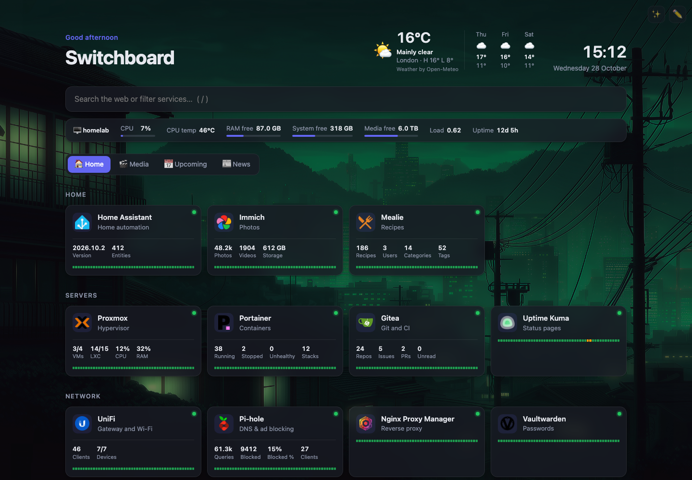

# Switchboard

**A small, self-hosted start page for your home lab.** Service tiles with live status,
stats from your apps' APIs, alerts, uptime bars and a combined media calendar. No
dependencies: one Python server and a vanilla HTML/JS front end.



**Full documentation, source and issues: [github.com/ahammerton/switchboard](https://github.com/ahammerton/switchboard)**

## Features

- **Tabs and groups** of service tiles, with icons and **live online/offline status**. Status checks run on the server, so CORS and self-signed certificates aren't a problem.
- **App widgets** for 29 apps: the \*arr suite, Seerr, Plex, Jellyfin, Emby, Tautulli, Komga, Proxmox, Portainer, Dockge, UniFi, Pi-hole, AdGuard Home, Technitium, Gitea, Home Assistant, Immich, qBittorrent, SABnzbd and more, plus any JSON API.
- **Bin collection card** with your next bin day and which bins go out, for 350+ UK councils via [UKBinCollectionData](https://github.com/robbrad/UKBinCollectionData).
- **Alerts** to Discord or any JSON webhook, and **24-hour uptime bars** on each tile.
- **Upcoming tab** combining Sonarr, Radarr, Lidarr, Readarr, Magarr and bin collections, a **News tab** (RSS), weather, and a **system stats bar** for the host.
- **Find services** scans your machines for apps that aren't on the dashboard yet.
- **In-browser editing**, protected by an edit token, and two styles: Normal and Glass.
- **Install as an app** on your phone (over HTTPS), with its own icon and full-screen view.

## Quick start

```sh
docker run -d --name switchboard --restart unless-stopped \
  -p 3000:3000 -v switchboard-config:/app/config \
  cyrune/switchboard:latest
```

Open `http://<server-ip>:3000`. An **edit token** is generated on first start and
printed in the log (`docker logs switchboard`). The dashboard asks for it the first
time you save a change.

With Docker Compose, use the repository's
[`docker-compose.yml`](https://github.com/ahammerton/switchboard/blob/main/docker-compose.yml).

## Configuration

| Env var | Purpose |
|---|---|
| `EDIT_TOKEN` | Set your own edit token, or `off` to allow changes without one |
| `ALLOWED_HOSTS` | Public host names you open the dashboard under, e.g. a reverse-proxy name like `dash.example.com`. IPs, `localhost` and `.lan`/`.local`/`.home.arpa`/`.internal` names always work |
| `HOST_NAME` | The name shown in the system stats bar |
| `TZ` | Time zone, e.g. `Europe/London` |

Everything Switchboard keeps (the config, API keys, the edit token, uptime history and
uploaded backgrounds) is in `/app/config`. Use a named volume as above. To use a folder
instead, create it owned by uid 1000 (the app's user) first, e.g.
`mkdir config && sudo chown 1000:1000 config`: a folder Docker creates itself is owned
by root, and the app can't write to it. API keys are stored unencrypted, so treat the
folder like a password store.

Run Switchboard on your home network, or behind a reverse proxy with its own login.
Don't expose it directly to the internet.

## Tags

| Tag | What it is |
|---|---|
| `latest` | The main branch |
| `1.2.3`, `1.2`, `1` | Releases (see the [changelog](https://github.com/ahammerton/switchboard/blob/main/CHANGELOG.md)) |
| `sha-<commit>` | One exact build |

Images are built for **amd64** and **arm64** (Raspberry Pi 4/5). The same images are
published as `ghcr.io/ahammerton/switchboard`.

## Licence

[Apache License 2.0](https://github.com/ahammerton/switchboard/blob/main/LICENSE).
